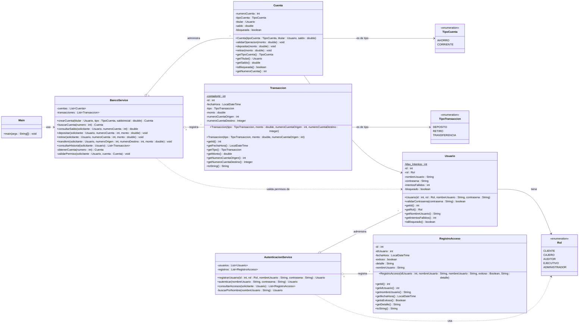

# SecureBank - Proyecto Integrador (Segundo avance)

**Facultad de Ingeniería - Programación Orientada a Objetos**

- **Proyecto:** SecureBank - sistema bancario con control de acceso por roles
- **Entrega:** 18 de octubre (Classroom) | Revisión en el salón: 28 de octubre

## Integrantes

| Integrante | Rol en el repositorio | Contribución |
|---|---|---|
| Ramirez Olvera Erick Yael (@1205-bot) | Administrador del repositorio | Desarrolló y corrigió: `Rol.java`, `Cuenta.java`, `TipoCuenta.java`, `Usuario.java`, `AutenticacionService.java`, `BancoService.java` |
| Hernández Morales Hanzel Noel (@Hanher-2025) | Desarrollador | Desarrolló y corrigió: `RegistroAcceso.java`, `Transaccion.java`, `TipoTransaccion.java`, `AutenticacionService.java`, `BancoService.java` |
| Santiago Carreto Héctor (@achesanticar) | Desarrollador | Corrigió: `RegistroAcceso.java`, `Transaccion.java`, `AutenticacionService.java`, `BancoService.java` |
---

## 1. Revisión del primer avance

**Problemática.** Se requiere un sistema bancario que distinga claramente las entidades del sistema (usuarios, cuentas bancarias, transacciones, etc.) para evitar operaciones inconsistentes o transacciones incorrectas.

**Objetivo general.** Desarrollar una aplicación en Java que administre usuarios (con distintos roles y permisos), cuentas bancarias (de distintos tipos) y transacciones, validando el estado de cada objeto y registrando un historial ordenado de operaciones y accesos.

**Alcance de esta etapa.** Aplicación de consola con datos en memoria (sin base de datos ni interfaz gráfica), con cuatro clases de dominio/servicio distribuidas en tres paquetes (`app`, `modelo` y `servicio`). Incluye la creación de cuentas de ahorro y corriente, depósitos, retiros, transferencias entre cuentas, control de permisos por rol, bloqueo de usuarios por intentos fallidos de contraseña e historial de transacciones. No se usa herencia ni polimorfismo, de acuerdo con el alcance de este avance, ni se implementa cifrado real de contraseñas.

### Ajustes realizados

**A partir de la retroalimentación del profesor:**
- **Se descartó el cobro en ventanilla.** Se eliminó del alcance la operación de cobro en ventanilla que se había planteado en el primer avance; el sistema se centra en operaciones entre cuentas.
- **Se conserva al Auditor.** El profesor indicó que podía incluirse o no; se decidió incluirlo. El auditor puede consultar el historial de transacciones, sin poder modificar nada.

**Por el alcance de esta etapa:**
- **Herencia reemplazada por enumeraciones.** En el primer avance se planteó `Usuario` como base de `Cliente`, `Administrador` y `Auditor`, y `Cuenta` como base de `CuentaAhorro` y `CuentaCorriente`. Como esta etapa no incluye herencia ni polimorfismo, se simplificó: una sola clase `Usuario` con un atributo `Rol`, y una sola clase `Cuenta` con un atributo `TipoCuenta`. La regla que diferencia a la cuenta de ahorro (retiro máximo del 90 % del saldo) se aplica dentro de `Cuenta.retirar`.
- **Separación entre reglas del objeto y reglas de acceso.** `Cuenta` valida montos y estado; `BancoService` valida quién puede operar cada cuenta según su rol.

Quedan para avances posteriores las funciones de gestión del Ejecutivo (asignar permisos a cuentas) y del Administrador (bloquear cuentas y usuarios, revocar roles).

---

## 2. Catálogo de clases

El sistema tiene cuatro clases de dominio/servicio (sin contar `Main`) y tres enumeraciones de apoyo.

### Clases

| Clase | Paquete | Responsabilidad |
|---|---|---|
| `Usuario` | modelo | Representa a una persona del sistema con un rol. Valida su contraseña y se bloquea tras 3 intentos fallidos. |
| `Cuenta` | modelo | Representa una cuenta bancaria. Guarda el saldo y aplica sus propias reglas al depositar y retirar (monto positivo, cuenta no bloqueada, límite del 90 % en cuentas de ahorro). |
| `Transaccion` | modelo | Registro inmutable de una operación (depósito, retiro o transferencia) con fecha, monto y cuentas involucradas. |
| `BancoService` | servicio | Coordina las operaciones del banco: crea y busca cuentas, valida permisos según el rol, ejecuta las operaciones y guarda el historial. |
| `Main` | app | Programa de demostración que prueba los casos principales. |

### Detalle por clase

**`Usuario`**
- Atributos: `id : int`, `rol : Rol`, `nombreUsuario : String`, `contrasena : String`, `intentosFallidos : int`, `bloqueado : boolean`.
- Métodos: `validarContrasena(contrasena) : boolean` y getters (`getId`, `getRol`, `getNombreUsuario`, `getIntentosFallidos`, `isBloqueado`).
- Relaciones: usa la enumeración `Rol`.

**`Cuenta`**
- Atributos: `numeroCuenta : int`, `tipoCuenta : TipoCuenta`, `titular : Usuario`, `saldo : double`, `bloqueada : boolean`.
- Métodos: `depositar(monto)`, `retirar(monto)`, `validarOperacion(monto)` (privado) y getters.
- Relaciones: pertenece a un `Usuario` (titular) y usa `TipoCuenta`.

**`Transaccion`**
- Atributos: `id : int`, `fechaHora : LocalDateTime`, `tipo : TipoTransaccion`, `monto : double`, `numeroCuentaOrigen : int`, `numeroCuentaDestino : Integer` (nulo en depósitos y retiros).
- Métodos: dos constructores (uno para transferencias y otro para depósitos/retiros), getters y `toString()`.
- Relaciones: usa `TipoTransaccion`.

**`BancoService`**
- Atributos: `cuentas : List<Cuenta>`, `transacciones : List<Transaccion>`.
- Métodos públicos: `crearCuenta`, `buscarCuenta`, `consultarSaldo`, `depositar`, `retirar`, `transferir`, `consultarHistorial`. Métodos privados: `obtenerCuenta`, `validarPermiso`.
- Relaciones: contiene muchas `Cuenta` y muchas `Transaccion`; recibe `Usuario` como solicitante de cada operación.

### Enumeraciones

| Enumeración | Valores |
|---|---|
| `Rol` | CLIENTE, CAJERO, AUDITOR, EJECUTIVO, ADMINISTRADOR |
| `TipoCuenta` | AHORRO, CORRIENTE |
| `TipoTransaccion` | DEPOSITO, RETIRO, TRANSFERENCIA |

### Reglas de negocio implementadas

- Solo un usuario con rol `CLIENTE` puede ser titular de una cuenta.
- Solo el titular de la cuenta o un `CAJERO` pueden operarla.
- Solo `ADMINISTRADOR` y `AUDITOR` pueden consultar el historial de transacciones.
- Las cuentas de ahorro solo permiten retirar hasta el 90 % del saldo.
- Si el depósito de una transferencia falla, el dinero se devuelve a la cuenta de origen.
- Un usuario se bloquea después de 3 contraseñas incorrectas consecutivas.

---

## 3. Diagrama UML de clases



**Notas de lectura:** `-` es visibilidad privada y `+` pública; `$` indica atributo estático. La flecha continua (`-->`) es asociación; el rombo vacío (`o--`) es agregación (el servicio contiene colecciones de cuentas y transacciones); la flecha punteada (`..>`) es dependencia (usa la clase, pero no la guarda como atributo).

---

## 4. Organización en paquetes

```
securebank/
├── README.md
├── .gitignore
└── src/
    ├── app/
    │   └── Main.java
    ├── modelo/
    │   ├── Rol.java
    │   ├── TipoCuenta.java
    │   ├── TipoTransaccion.java
    │   ├── Usuario.java
    │   ├── Cuenta.java
    │   └── Transaccion.java
    └── servicio/
        └── BancoService.java
```

**Por qué esta organización:**

- **`modelo`**: contiene las clases que representan los datos y las reglas propias de cada objeto (una cuenta sabe validar sus depósitos y retiros; un usuario sabe validar su contraseña). No depende de ningún otro paquete.
- **`servicio`**: contiene la lógica que coordina varios objetos (permisos, transferencias, historial). Depende de `modelo`.
- **`app`**: contiene el punto de entrada. Depende de `modelo` y `servicio`, y nada depende de él.

Las dependencias van en una sola dirección (`app` → `servicio` → `modelo`), lo que permite cambiar o ampliar una capa sin romper las anteriores.

---

## 5. Implementación en Java

Se aplicó lo siguiente:

- **Encapsulamiento:** todos los atributos son `private`; el acceso se hace mediante getters. Solo se exponen setters o métodos de cambio de estado donde tienen sentido (por ejemplo, `depositar` y `retirar` en lugar de un `setSaldo`).
- **Constructores con validación:** `Usuario`, `Cuenta` y `Transaccion` rechazan parámetros nulos o inválidos lanzando `IllegalArgumentException`.
- **Inmutabilidad:** los atributos que no deben cambiar son `final` (por ejemplo, el titular y el número de cuenta, o todos los datos de una transacción).
- **Sobrecarga de constructores:** `Transaccion` tiene un constructor para transferencias y otro para depósitos y retiros.
- **Enumeraciones** para los valores cerrados (`Rol`, `TipoCuenta`, `TipoTransaccion`).
- **Manejo de excepciones:** se usan excepciones estándar (`IllegalArgumentException`, `IllegalStateException`, `SecurityException`) con mensajes claros, y `try/catch` para revertir una transferencia fallida.
- **Imports entre paquetes:** `servicio` importa clases de `modelo`; `app` importa de ambos.

---

## 6. Cómo compilar y ejecutar

**Requisitos:** JDK 11 o superior (verifica con `javac -version`).

Desde la **raíz del proyecto** (la carpeta `securebank`, no desde `src`):

**Windows (PowerShell)**
```powershell
mkdir out
javac -encoding UTF-8 -d out (Get-ChildItem -Path src -Recurse -Filter *.java).FullName
java -cp out app.Main
```

**Linux / macOS**
```bash
mkdir -p out
javac -encoding UTF-8 -d out $(find src -name "*.java")
java -cp out app.Main
```

Importante: se ejecuta `app.Main` (con el nombre del paquete). Si se ejecuta solo `Main` aparece `ClassNotFoundException`.

---

## 7. Demostración y pruebas

`Main` ejecuta una serie de casos y marca cada uno con `[OK]` o `[ERROR]`. Los casos marcados "debe fallar" son errores esperados: demuestran que las validaciones funcionan. Los números de cuenta se generan al azar, así que cambian en cada ejecución.

### Prueba 1 - Retiro con límite del 90 % en cuenta de ahorro

| | |
|---|---|
| **Funcionalidad** | `Cuenta.retirar` / `BancoService.retirar` |
| **Entrada** | Cuenta AHORRO de Ana con saldo 1500. Ana intenta retirar 1400 y luego 1350. |
| **Resultado esperado** | El retiro de 1400 se rechaza ("Saldo insuficiente") porque supera el 90 % (1350). El retiro de 1350 se realiza y el saldo queda en 150. |
| **Resultado obtenido** | Coincide con lo esperado. |

```
[ERROR] Ana retira 1400 de AHORRO (excede el 90%, debe fallar) -> IllegalArgumentException: Saldo insuficiente
[OK]    Ana retira 1350 de AHORRO (justo el 90%, debe funcionar)
Saldo de Ana: 150.0
```

### Prueba 2 - Transferencia entre cuentas y permisos por rol

| | |
|---|---|
| **Funcionalidad** | `BancoService.transferir`, `consultarSaldo` y `validarPermiso` |
| **Entrada** | Luis (saldo 300) transfiere 100 a Ana (saldo 150). Después se prueban: transferencia a la misma cuenta, a una cuenta inexistente y por un monto mayor al saldo; y consultas de saldo por Luis (cliente ajeno), por un cajero y sin sesión. |
| **Resultado esperado** | Saldos finales: Luis 200, Ana 250. Las tres transferencias inválidas se rechazan y el saldo de Luis no cambia. Luis no puede ver la cuenta de Ana, el cajero sí, y sin sesión se rechaza. |
| **Resultado obtenido** | Coincide con lo esperado. |

```
[OK]    Luis transfiere 100 a Ana
Saldo de Luis: 200.0
Saldo de Ana: 250.0
[ERROR] Transferir a la misma cuenta (debe fallar) -> IllegalArgumentException: La cuenta origen y destino deben ser distintas
[ERROR] Transferir a cuenta inexistente (debe fallar) -> IllegalArgumentException: No existe la cuenta 999999999
[ERROR] Transferir mas de lo que hay (debe fallar) -> IllegalArgumentException: Saldo insuficiente
Saldo de Luis (no debio cambiar): 200.0
[ERROR] Luis consulta el saldo de Ana (debe fallar) -> SecurityException: No tienes permiso para operar esta cuenta
   Saldo: 250.0
[OK]    Cajero consulta el saldo de Ana (debe funcionar)
[ERROR] Sin sesion (null) consulta saldo (debe fallar) -> SecurityException: Debes iniciar sesión
```

### Prueba 3 - Historial de transacciones restringido por rol

| | |
|---|---|
| **Funcionalidad** | `BancoService.consultarHistorial` |
| **Entrada** | Se intenta ver el historial con un cliente, un cajero, un auditor y un administrador. |
| **Resultado esperado** | Cliente y cajero son rechazados. Auditor y administrador ven las 4 transacciones realizadas (depósito, dos retiros y una transferencia). |
| **Resultado obtenido** | Coincide con lo esperado. |

```
[ERROR] Cliente intenta ver el historial (debe fallar) -> SecurityException: Solo administrador o auditor pueden ver el historial
[ERROR] Cajero intenta ver el historial (debe fallar) -> SecurityException: Solo administrador o auditor pueden ver el historial
Historial visto por el AUDITOR:
   #1 | 2026-10-18T13:22:15.994438 | DEPOSITO | $500.0 | cuenta 477477
   #2 | 2026-10-18T13:22:15.998438 | RETIRO | $200.0 | cuenta 433707
   #3 | 2026-10-18T13:22:16.002437300 | RETIRO | $1350.0 | cuenta 477477
   #4 | 2026-10-18T13:22:16.005437200 | TRANSFERENCIA | $100.0 | cuenta 433707 -> 477477
Historial visto por el ADMINISTRADOR: 4 transacciones
```

### Prueba 4 - Bloqueo de usuario por intentos fallidos

| | |
|---|---|
| **Funcionalidad** | `Usuario.validarContrasena` |
| **Entrada** | Se ingresa 4 veces una contraseña incorrecta y después la correcta. |
| **Resultado esperado** | El usuario se bloquea al tercer intento fallido; después de eso ni la contraseña correcta permite el acceso. |
| **Resultado obtenido** | Coincide con lo esperado. |

```
Intento 3 -> acceso: false | fallidos: 3 | bloqueado: true
Intento 4 -> acceso: false | fallidos: 3 | bloqueado: true
Luis con su contrasena correcta estando bloqueado: false
```
### Evidencia de ejecución

Salida completa de `java -cp out app.Main` (rama `staging`, Windows). Los números de cuenta cambian en cada ejecución porque se generan al azar.

```
=== 1. Crear cuentas ===
Cuenta de Ana (AHORRO): 477477
Cuenta de Luis (CORRIENTE): 433707
[ERROR] Crear cuenta con titular que NO es CLIENTE (debe fallar) -> IllegalArgumentException: El titular debe ser un usuario con rol CLIENTE
[ERROR] Crear cuenta con saldo negativo (debe fallar) -> IllegalArgumentException: El saldo inicial no puede ser negativo

=== 2. Depositar ===
[OK]    Ana deposita 500 en su cuenta
Saldo de Ana: 1500.0
[ERROR] Depositar monto 0 (debe fallar) -> IllegalArgumentException: El monto debe ser mayor a cero

=== 3. Retirar ===
[OK]    Luis retira 200 (corriente)
Saldo de Luis: 300.0
[ERROR] Luis retira 1000 (saldo insuficiente, debe fallar) -> IllegalArgumentException: Saldo insuficiente
[ERROR] Ana retira 1400 de AHORRO (excede el 90%, debe fallar) -> IllegalArgumentException: Saldo insuficiente
[OK]    Ana retira 1350 de AHORRO (justo el 90%, debe funcionar)
Saldo de Ana: 150.0

=== 4. Transferencias ===
[OK]    Luis transfiere 100 a Ana
Saldo de Luis: 200.0
Saldo de Ana: 250.0
[ERROR] Transferir a la misma cuenta (debe fallar) -> IllegalArgumentException: La cuenta origen y destino deben ser distintas
[ERROR] Transferir a cuenta inexistente (debe fallar) -> IllegalArgumentException: No existe la cuenta 999999999
[ERROR] Transferir mas de lo que hay (debe fallar) -> IllegalArgumentException: Saldo insuficiente
Saldo de Luis (no debio cambiar): 200.0

=== 5. Permisos ===
[ERROR] Luis consulta el saldo de Ana (debe fallar) -> SecurityException: No tienes permiso para operar esta cuenta
   Saldo: 250.0
[OK]    Cajero consulta el saldo de Ana (debe funcionar)
[ERROR] Sin sesion (null) consulta saldo (debe fallar) -> SecurityException: Debes iniciar sesión

=== 6. Historial ===
[ERROR] Cliente intenta ver el historial (debe fallar) -> SecurityException: Solo administrador o auditor pueden ver el historial
[ERROR] Cajero intenta ver el historial (debe fallar) -> SecurityException: Solo administrador o auditor pueden ver el historial
Historial visto por el AUDITOR:
   #1 | 2026-10-18T13:22:15.994438 | DEPOSITO | $500.0 | cuenta 477477
   #2 | 2026-10-18T13:22:15.998438 | RETIRO | $200.0 | cuenta 433707
   #3 | 2026-10-18T13:22:16.002437300 | RETIRO | $1350.0 | cuenta 477477
   #4 | 2026-10-18T13:22:16.005437200 | TRANSFERENCIA | $100.0 | cuenta 433707 -> 477477
Historial visto por el ADMINISTRADOR: 4 transacciones

=== 7. Bloqueo de usuario (3 intentos fallidos) ===
Intento 1 -> acceso: false | fallidos: 1 | bloqueado: false
Intento 2 -> acceso: false | fallidos: 2 | bloqueado: false
Intento 3 -> acceso: false | fallidos: 3 | bloqueado: true
Intento 4 -> acceso: false | fallidos: 3 | bloqueado: true
Luis con su contrasena correcta estando bloqueado: false
```

---

## 8. Reflexión y plan

### Decisiones de diseño

- **Cada clase valida lo suyo.** `Cuenta` decide si un depósito o retiro es válido (monto, bloqueo, límite del 90 %), y `BancoService` decide *quién* puede pedirlo. Así las reglas de la cuenta viajan con la cuenta y el servicio no las duplica.
- **`Transaccion` guarda números de cuenta, no objetos `Cuenta`.** El historial queda independiente de las cuentas y no se pueden alterar los saldos desde un registro histórico. Además es inmutable.
- **Enumeraciones en lugar de textos o números** para roles y tipos, para evitar valores inválidos y errores de escritura.
- **Tres paquetes con dependencias en una sola dirección** (`app` → `servicio` → `modelo`).
- **`BancoService` devuelve una copia del historial**, para que quien lo consulte no pueda modificar la lista interna.

### Problemas técnicos encontrados

1. **Números de cuenta repetidos.** Como se generan al azar, dos cuentas podían recibir el mismo número. Se resolvió en `crearCuenta` con un ciclo que genera una cuenta nueva mientras el número ya exista en el sistema.
2. **Transferencias a medias.** Si el retiro de la cuenta origen se hacía y el depósito en la destino fallaba (por ejemplo, cuenta bloqueada), el dinero desaparecía. Se resolvió con `try/catch`: si falla el depósito, se devuelve el dinero a la cuenta origen y se relanza el error.
3. **Constructor de `Transaccion` mal usado desde el servicio.** El servicio le pasaba objetos `Cuenta` y el constructor esperaba números de cuenta. Se corrigió usando `getNumeroCuenta()` y los dos constructores sobrecargados.
4. **Compilación con paquetes.** Compilar y ejecutar solo funciona desde la raíz del proyecto y con el nombre completo `app.Main`.

### Pendientes y plan para los siguientes avances

- Corregir `Transaccion.toString()`: el formato usa `%d` para una fecha (`LocalDateTime`) y falla al imprimir una transacción. `Main` no lo dispara porque imprime con getters.
- Generar el número de cuenta en un rango que excluya el 0 (hoy puede salir 0 con probabilidad muy baja y `Transaccion` lo rechaza).
- Agregar métodos para bloquear y desbloquear cuentas desde `BancoService` (hoy la cuenta tiene el atributo, pero no hay forma de activarlo).
- Las contraseñas se guardan en texto plano; en un avance posterior deberían almacenarse con hash.
- Los datos viven solo en memoria; más adelante se podría persistir en archivos o base de datos.
- Incorporar herencia, polimorfismo y patrones de diseño cuando el curso los solicite.

---

## 9. Autoría y herramientas

- `Main.java` se generó con ayuda de Claude (Anthropic).
- `BancoService.java` se corrigió con apoyo de Claude a partir de un borrador propio del equipo.
- Las demás clases fueron escritas y ajustadas por el equipo. 