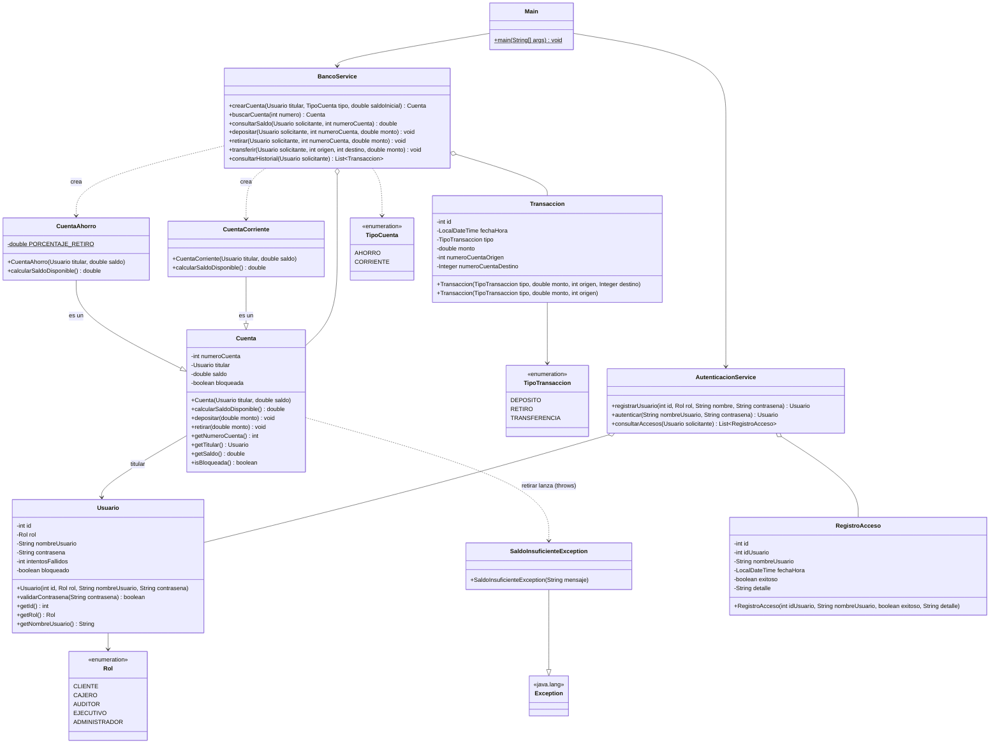

# SecureBank - Proyecto Integrador (Tercer avance)

**Facultad de Ingeniería - Programación Orientada a Objetos**

- **Proyecto:** SecureBank - sistema bancario con control de acceso por roles
- **Entrega:** 8 de noviembre (Classroom) | Revisión en el salón: 13 de octubre

## Integrantes

| Integrante | Rol en el repositorio | Contribución |
|---|---|---|
| Ramirez Olvera Erick Yael (@1205-bot) | Administrador del repositorio | Desarrolló y corrigió: `CuentaAhorro.java`, `CuentaCorriente.java`, `Rol.java`, `Cuenta.java`, `TipoCuenta.java`, `Usuario.java`, `AutenticacionService.java`, `BancoService.java` |
| Hernández Morales Hanzel Noel (@Hanher-2025) | Desarrollador | Desarrolló y corrigió: `CuentaAhorro.java`, `CuentaCorriente.java`, `RegistroAcceso.java`, `Transaccion.java`, `TipoTransaccion.java`, `AutenticacionService.java`, `BancoService.java` |
| Santiago Carreto Héctor (@achesanticar) | Desarrollador  | Desarrolló y corrigió: `CuentaAhorro.java`, `CuentaCorriente.java`, `RegistroAcceso.java`, `Transaccion.java`, `AutenticacionService.java`, `BancoService.java` |
---

## Versión de Java

Probado con OpenJDK 25 (Temurin). El código usa `String.isBlank`, por lo que compila con JDK 11 o superior.

---

## Estructura del proyecto
```
securebank/
├── README.md
├── .gitignore
└── src/
    ├── app/
    │   └── Main.java
    ├── excepciones/
    │   └── SaldoInsuficienteException.java
    ├── modelo/
    │   ├── Rol.java
    │   ├── TipoCuenta.java
    │   ├── TipoTransaccion.java
    │   ├── Usuario.java
    │   ├── Cuenta.java
    │   ├── CuentaAhorro.java
    │   ├── CuentaCorriente.java
    │   └── Transaccion.java
    └── servicio/
        ├── BancoService.java
        └── AutenticacionService.java
```

---

## Versión entregada

- **Repositorio:** https://github.com/1205-bot/securebank.git
- **Commit de entrega:** 
  (Merge pull request #21 from 1205-bot/feature/excepciones, rama `main`)
- **Tag:** `entrega-tercer-avance`

---

## Compilar y ejecutar

```bash
javac -d out "src/excepciones/*.java" "src/modelo/*.java" "src/servicio/*.java" "src/app/*.java"
java "-Dstdout.encoding=UTF-8" -cp out app.Main
```

Usuarios iniciales: `ana/1234` y `luis/abcd` (CLIENTE), `cajero1/caja` (CAJERO), `auditor1/audit` (AUDITOR), `admin/root` (ADMINISTRADOR).

---

## Funcionalidades

1. Registrar usuario y autenticar con bloqueo tras 3 intentos fallidos (segundo avance).
2. Consultar accesos (solo ADMINISTRADOR o AUDITOR, segundo avance).
3. Crear cuentas de ahorro o corriente para usuarios CLIENTE.
4. Depositar, retirar y transferir con permisos (titular o cajero) y devolución del dinero si el destino rechaza una transferencia.
5. Consultar saldo (muestra el polimorfismo), historial de transacciones.

El sistema tiene ocho clases de dominio/servicio (sin contar `Main`) y tres enumeraciones de apoyo.

---

## Herencia y polimorfismo

- Relación "es un": `CuentaAhorro` y `CuentaCorriente` son tipos de `Cuenta`. La base concentra lo común (número, titular, saldo, bloqueo, `depositar`, `retirar`, validaciones) y las subclases solo agregan su regla de retiro.
- Método polimórfico: `calcularSaldoDisponible()`, definido en `Cuenta` y sobrescrito con `@Override` en ambas subclases: ahorro permite retirar el 90% del saldo, corriente el 100%.
- En `Main.consultarSaldo` la referencia es del tipo base `Cuenta` y se llama al mismo método sobre cada objeto; la salida muestra la clase real y el resultado distinto (casos P1 y P2).
- Constructores: `this` para distinguir atributos de parámetros en la base y `super(...)` en las subclases. Atributos privados con getters.

---

## Excepciones

| Excepción | Situación | Dónde se lanza / captura |
|---|---|---|
| `NumberFormatException` | Texto donde se espera número (se lee línea y se parsea) | `Integer.parseInt`/`Double.parseDouble` en `Main`; catch con mensaje de cómo corregir |
| `IllegalArgumentException` | Monto ≤ 0, saldo negativo, usuario duplicado, cuenta inexistente, tipo inválido | Método responsable del dato; catch en `Main` |
| `IllegalStateException` | Cuenta bloqueada | `Cuenta.validarOperacion`; catch en `Main` |
| `SecurityException` | Sin sesión o sin permiso | Servicios; catch en `Main` |
| `SaldoInsuficienteException` (propia, verificada) | Retirar más de lo disponible | `throw` en `Cuenta.retirar`, declarada con `throws` hasta `BancoService`; catch en `Main` |

- `try-catch-finally` verdadero en `Main.retirar`: `finally` imprime «Intento de retiro finalizado.» en éxito y fallo; la confirmación de éxito solo se imprime dentro del `try`.
- `NumberFormatException` se captura antes que `IllegalArgumentException` por ser su subclase.
- Se valida antes de modificar datos: un rechazo no cambia saldos ni registra transacciones (P5).
- Tras un fallo controlado el menú continúa y acepta la siguiente operación (P6).

---

## Casos de prueba P1–P7

Sigue los pasos en orden dentro de una misma ejecución: se crean la cuenta 1 (ana, AHORRO, 1000) y la cuenta 2 (luis, CORRIENTE, 500). Toma captura de cada caso para el reporte.

| Caso | Pasos en el menú | Esperado y obtenido |
|---|---|---|
| P1 | sesión ana → 3 (tipo 1, saldo 1000) → 4 (cuenta 1) | Referencia `Cuenta` apunta a `CuentaAhorro`: saldo 1000.00, disponible 900.00 |
| P2 | sesión luis → 3 (tipo 2, saldo 500) → 4 (cuenta 2) | Referencia `Cuenta` apunta a `CuentaCorriente`: saldo 500.00, disponible 500.00 |
| P3 | 5 (cuenta 2, monto `abc`) | `NumberFormatException` capturada; mensaje indica usar números |
| P4 | 5 (cuenta 2, monto 0) | `IllegalArgumentException` («El monto debe ser mayor a cero»); saldo no cambia |
| P5 | 4 (cuenta 2) → 6 (cuenta 2, 1000) → 4 (cuenta 2) | `SaldoInsuficienteException`; estado antes y después: saldo 500.00 |
| P6 | 5 (cuenta 2, 100) tras el fallo | Depósito realizado, saldo 600.0; la sesión continúa |
| P7 | 6 (cuenta 2, 50) y 6 (cuenta 2, 99999) | «Intento de retiro finalizado.» en ambos; «Retiro realizado» solo en el válido |

---

## Cambios respecto al segundo avance

- La regla del 90% dejó de ser un `if` por `TipoCuenta` dentro de `Cuenta`: ahora vive en las subclases (herencia + polimorfismo observable).
- «Saldo insuficiente» pasó de `IllegalArgumentException` a la excepción propia verificada `SaldoInsuficienteException`.
- `Main` pasó de demostración escrita a menú interactivo por consola con operaciones sucesivas y salida.
- Números de cuenta secuenciales en lugar de aleatorios, para que los casos sean reproducibles con los mismos números.
- Correcciones: `Transaccion.toString()` (fecha con `%s` y destino formateado), llave sobrante en `Rol`, constante `MAX_INTENTOS` con el naming acordado.

---

## Limitaciones conocidas

- Datos en memoria: todo se pierde al salir (la entrega no pide persistencia).
- Solo consola; sin interfaz gráfica ni base de datos.
- El atributo `bloqueada` de `Cuenta` se hereda del avance anterior; aún no hay operación que bloquee cuentas.

---


## Diagrama UML de clases

Diagrama de clases de la versión entregada. La flecha de generalización va de cada subclase a la clase base; `SaldoInsuficienteException` hereda de `Exception`.



Notas:

- `retirar` en `Cuenta`, `BancoService.retirar` y `BancoService.transferir` declaran `throws SaldoInsuficienteException`; `Main` la captura.
- `calcularSaldoDisponible()` está sobrescrito con `@Override` en ambas subclases (90% en ahorro, 100% en corriente).
- Los getters restantes se omiten del diagrama por brevedad; todos los atributos son privados (`-`) y los métodos públicos (`+`); `$` marca miembro estático.

--- 