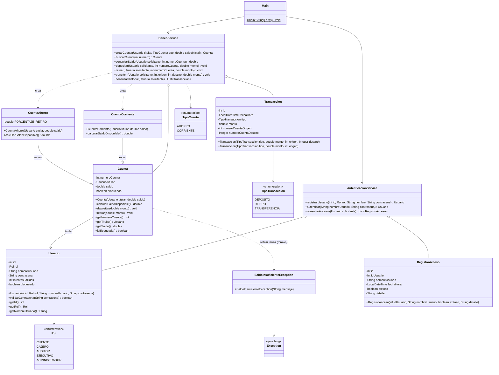

# SecureBank - Proyecto Integrador (Cuarto Avance - version final)


**Facultad de Ingeniería - Programación Orientada a Objetos**

- **Proyecto:** SecureBank - sistema bancario con control de acceso por roles
- **Estado:** versión de cierre. Cuatro funcionalidades completas, flujo de consola estable, P1–P8 verificables.

## Integrantes

| Integrante | Rol en el repositorio | Contribución |
|---|---|---|
| Ramirez Olvera Erick Yael (@1205-bot) | Administrador del repositorio | Desarrolló y corrigió: `CuentaAhorro.java`, `CuentaCorriente.java`, `Rol.java`, `Cuenta.java`, `TipoCuenta.java`, `Usuario.java`, `AutenticacionService.java`, `BancoService.java`, integración y correcciones del cierre |
| Hernández Morales Hanzel Noel (@Hanher-2025) | Desarrollador | Desarrolló y corrigió: `CuentaAhorro.java`, `CuentaCorriente.java`, `RegistroAcceso.java`, `Transaccion.java`, `TipoTransaccion.java`, `AutenticacionService.java`, `BancoService.java` |
| Santiago Carreto Héctor (@achesanticar) | Desarrollador | Corrigió: `CuentaAhorro.java`, `CuentaCorriente.java`, `RegistroAcceso.java`, `Transaccion.java`, `AutenticacionService.java`, `BancoService.java` |

---

## Versión de Java

- Probado con **OpenJDK 25 (Temurin)** en Windows 11, compilado desde terminal (CMD o PowerShell) y desde **Apache NetBeans** abriendo la carpeta del proyecto.

- No usa librerías externas ni rutas absolutas: solo JDK y la carpeta `src`.

- Compila con JDK 11 o superior (usa `String.isBlank` y `LocalDateTime`).

---

## Estructura del proyecto
```
securebank/
├── README.md
├── .gitignore
└── src/
    ├── app/
    │   └── Main.java
    ├── excepciones/
    │   └── SaldoInsuficienteException.java
    ├── modelo/
    │   ├── Rol.java
    │   ├── TipoCuenta.java
    │   ├── TipoTransaccion.java
    │   ├── Usuario.java
    │   ├── Cuenta.java
    │   ├── CuentaAhorro.java
    │   ├── CuentaCorriente.java
    │   └── Transaccion.java
    └── servicio/
        ├── BancoService.java
        └── AutenticacionService.java
```

---

## Compilar y ejecutar

```bash
javac -d out "src/excepciones/*.java" "src/modelo/*.java" "src/servicio/*.java" "src/app/*.java"
java "-Dstdout.encoding=UTF-8" -cp out app.Main
```

Usuarios iniciales: `ana/1234` y `luis/abcd` (CLIENTE), `cajero1/caja` (CAJERO), `auditor1/audit` (AUDITOR), `admin/root` (ADMINISTRADOR).

---

## Datos de ejemplo

| Usuario | Contraseña | Rol |
|---|---|---|
| ana | 1234 | CLIENTE |
| luis | abcd | CLIENTE |
| cajero1 | caja | CAJERO |
| auditor1 | audit | AUDITOR |
| admin | root | ADMINISTRADOR |

---

## Menú

```
1 Iniciar sesión   2 Registrar usuario   3 Crear cuenta   4 Consultar saldo
5 Depositar        6 Retirar             7 Transferir     8 Consultar historial
9 Consultar accesos                      0 Salir
```

`0` sale del bucle y muestra «Sesion finalizada.»; una opción fuera de rango no cierra el programa. Los números de cuenta son secuenciales (1, 2, 3…) para que las pruebas sean reproducibles; el contador se reinicia en cada ejecución.

---

## Funcionalidades

1. **Cuentas**: un CLIENTE crea cuenta de AHORRO o CORRIENTE con saldo inicial; el tipo define la regla de retiro.
2. **Depósitos y retiros**: monto > 0, cuenta no bloqueada y retiro limitado al saldo disponible del tipo de cuenta.
3. **Transferencias**: entre cuentas propias o de terceros, con permiso del origen y reversión del retiro si el destino rechaza el depósito.
4. **Consultas**: saldo (muestra el polimorfismo), historial de transacciones (auditor/administrador) y registro de accesos (auditor/administrador).
5. **Soporte**: registro de usuarios y autenticación con bloqueo tras 3 intentos fallidos.

---

## Herencia y polimorfismo

- `CuentaAhorro` y `CuentaCorriente` **heredan** de `Cuenta`; la base concentra estado, validaciones, `depositar` y `retirar`.
- `calcularSaldoDisponible()` se **sobrescribe con `@Override`**: ahorro devuelve `saldo * 0.9`, corriente devuelve `saldo`.
- En `Main.consultarSaldo` la referencia es del **tipo base** (`Cuenta cuenta = banco.buscarCuenta(numero)`) y la misma llamada produce resultados distintos (P1 y P2); se imprime `getClass().getSimpleName()` para que el efecto sea observable.
- Constructores: `this` en la base para separar atributo de parámetro y `super(titular, saldo)` en las subclases. Atributos privados, expuestos con getters.

---

## Excepciones

| Excepción | Situación | Dónde se lanza / captura |
|---|---|---|
| `NumberFormatException` | Texto donde se espera número (se lee línea y se parsea) | `Integer.parseInt`/`Double.parseDouble` en `Main`; catch con mensaje de cómo corregir |
| `IllegalArgumentException` | Monto ≤ 0, saldo negativo, usuario duplicado, cuenta inexistente, tipo inválido | Método responsable del dato; catch en `Main` |
| `IllegalStateException` | Cuenta bloqueada | `Cuenta.validarOperacion`; catch en `Main` |
| `SecurityException` | Sin sesión o sin permiso | Servicios; catch en `Main` |
| `SaldoInsuficienteException` (propia, verificada) | Retirar más de lo disponible | `throw` en `Cuenta.retirar`, declarada con `throws` hasta `BancoService`; catch en `Main` |

- `Main.retirar` usa `try-catch-finally`: el `finally` imprime «Intento de retiro finalizado.» tanto en éxito como en fallo, y el mensaje de confirmación solo se escribe dentro del `try` (P7).
- Se valida **antes** de mutar: un rechazo no cambia saldos ni deja transacciones registradas (P5 y prueba complementaria de transferencia).

---

## Casos de prueba P1–P8

Cada caso parte de una ejecución nueva (`java ... app.Main`). En P1–P7 la cuenta que se crea es la número **1**; en P8 aparecen la 1 (ana) y la 2 (luis).

| Caso | Situacion | Pasos | Resultado que se comprueba |
|---|---|---|
| P1 | Polimorfismo (ahorro) | ana/1234 → 3, tipo 1, saldo 1000 → 4, cuenta 1 | Cuenta 1 (CuentaAhorro) | saldo: 1000.00 | disponible: 900.00 |
| P2 | Polimorfismo (corriente) | luis/abcd → 3, tipo 2, saldo 500 → 4, cuenta 1 | Cuenta 1 (CuentaCorriente) | saldo: 500.00 | disponible: 500.00 |
| P3 | Formato incorrecto | ana → 3, tipo 1, 1000 → 5, cuenta 1, monto abc | «Formato incorrecto: la cuenta es un entero y el monto un número.» |
| P4 | Dato que viola una regla | ana → 3, tipo 1, 1000 → 5, cuenta 1, monto -50 | «Operación rechazada: El monto debe ser mayor a cero» (IllegalArgumentException) |
| P5 | Excepción propia | luis → 3, tipo 2, 500 → 4 → 6, monto 1000 → 4 | Rechazo con «saldo disponible 500.00, monto solicitado 1000.00»; saldo 500.00 antes y después |
| P6 | Acción válida tras el error | continuar P5 → 5, cuenta 1, monto 100 → 4 | «Deposito realizado. Nuevo saldo: 600.0»; el programa sigue operando |
| P7 | finally en éxito y fallo | luis → 3, tipo 2, 500 → 6, monto 50 → 6, monto 99999 | «Intento de retiro finalizado.» en los dos intentos; «Retiro realizado» solo en el válido |
| P8 | Flujo integrado | ana: 3 (1, 1000) → 5 (1, 200) → 6 (1, 1000) → 4 (1); luis: 3 (2, 500) → 7 (origen 2, destino 1, 100) → 4 (2); auditor1: 8; admin: 9 | Depósito 1200.0 → retiro deja saldo 200.0 (disponible 180.0) → transferencia OK → cuenta 2 en 400.0; historial con 3 transacciones; 4 accesos registrados |

**Prueba complementaria (atomicidad):** ana → 3 (1, 1000) → 7 (origen 1, destino 99, monto 100) → 4 (1). Sale «No existe la cuenta 99» y el saldo de la cuenta 1 sigue en 1000.00: un fallo controlado no deja cambios parciales.

---

## Cambios respecto al tercer avance

| Problema detectado | Ajuste | Cómo se comprobó |
|---|---|---|
| El repositorio guardaba `src/excepciones/SaldoInsuficiente.java`, un duplicado con la clase `SaldoInsuficienteException` dentro | Se elimina el archivo duplicado y queda solo `SaldoInsuficienteException.java` | Clon limpio de `develop` → antes fallaba con 2 errores de compilación; ahora compila sin errores |
| `Transaccion.toString()` usaba `%d` para un `LocalDateTime` y reventaba al consultar el historial | Formato con `%s` para la fecha y separador consistente | P8, opción 8: imprime `[2026-11-19T17:33:45...] ID: 1 \| Tipo: DEPOSITO \| Monto: 200.00 \| Cuenta: 1` |
| La confirmación de éxito del retiro se imprimia aunque la operación fallara | El mensaje queda dentro del `try` y el `finally` solo reporta el cierre del intento | P7: éxito y fallo comparten el `finally`, pero «Retiro realizado» aparece una sola vez |
| Constante con nombre inconsistente (`Max_Intentos`) | Renombrada a `MAX_INTENTOS` | Recompilación completa sin errores |
| Pasos de prueba que dependían de números de cuenta aleatorios | Contador secuencial y tabla P1–P8 reescrita con los números reales | Ejecuciones automatizadas de P1–P8, todas con el resultado esperado |

---

## Limitaciones conocidas

- Datos en memoria: al salir se pierde todo (la entrega no pide persistencia).
- Solo consola: la **interfaz gráfica es un elemento opcional** de la entrega y el equipo decidió no implementarla; tampoco base de datos, red ni bibliotecas externas.
- El atributo `bloqueada` de `Cuenta` existe y se valida, pero ninguna operación lo activa todavía: no hay acción de bloqueo de cuentas en el menú.
- El historial y los accesos son globales (no por cuenta); se muestran completos a quien tenga permiso.
- **Elementos opcionales**: no se implementaron patrones de diseño ni hilos. El patrón Strategy se estudió en la Práctica 13 como propuesta de mejora para las reglas de retiro, pero no forma parte de esta versión.

---


## Diagrama UML de clases

Diagrama de clases de la versión entregada. La flecha de generalización va de cada subclase a la clase base; `SaldoInsuficienteException` hereda de `Exception`.



Notas:

- `retirar` en `Cuenta`, `BancoService.retirar` y `BancoService.transferir` declaran `throws SaldoInsuficienteException`; `Main` la captura.
- `calcularSaldoDisponible()` está sobrescrito con `@Override` en ambas subclases (90% en ahorro, 100% en corriente).
- Los getters restantes se omiten del diagrama por brevedad; todos los atributos son privados (`-`) y los métodos públicos (`+`); `$` marca miembro estático.

--- 